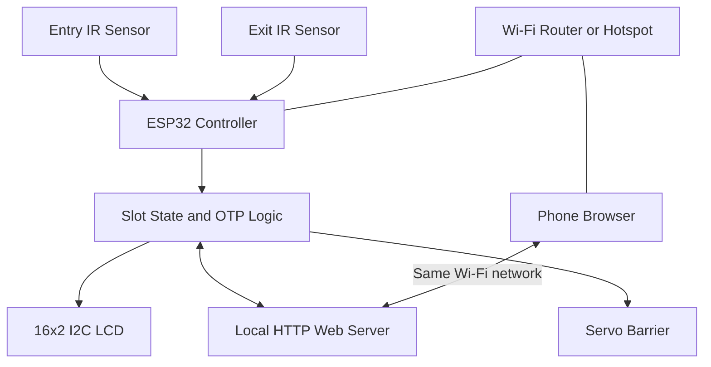

# ESP32 Smart Parking Access System with Web-Based OTP Verification

An individual ECE prototype using an ESP32, two IR sensors, a 16×2 I²C LCD, a servo barrier and a local browser-based OTP interface.

> **Status:** Firmware and documentation package prepared. End-to-end physical validation and demonstration evidence are pending. Do not interpret the test plan as completed test results.

## Overview

The prototype models **one parking slot**. When an entry vehicle is detected and the slot is free, the ESP32 generates a four-digit OTP and displays it with its local IP address. A phone on the same Wi-Fi network opens the ESP32 web page and submits the OTP. Successful verification marks the slot occupied and opens the servo barrier.

At exit, the second IR sensor activates exit verification. The user submits the same session OTP. Successful verification releases the slot, clears the OTP and opens the barrier.

## Architecture

GitHub renders this Mermaid block diagram:



## Hardware

| Component | Qty | Purpose |
|---|---:|---|
| ESP32 development board (CP2102 USB-UART) | 1 | Controller, Wi-Fi and web server |
| SG90 servo | 1 | Model barrier |
| 16×2 I²C LCD | 1 | OTP, IP and status |
| IR obstacle sensor modules | 2 | Entry and exit detection |
| Breadboard and jumper wires | As required | Prototype wiring |
| Regulated 5 V supply | 1 recommended | Servo power |

Wiring: [hardware/pinout.md](hardware/pinout.md) · Bill of materials and electrical notes: [hardware/components.md](hardware/components.md).

## Repository

```text
.
├── README.md
├── LICENSE
├── .gitignore
├── CHANGELOG.md
├── src/SmartParking/
│   ├── SmartParking.ino
│   └── secrets.example.h
├── hardware/
│   ├── components.md
│   └── pinout.md
├── docs/
│   ├── algorithm.md
│   ├── design-decisions.md
│   └── testing.md
└── media/README.md
```

## Firmware setup

1. Install Arduino IDE and the **esp32 by Espressif Systems** board package.
2. Add this Boards Manager URL if needed: `https://raw.githubusercontent.com/espressif/arduino-esp32/gh-pages/package_esp32_index.json`
3. Install **ESP32Servo** and **LiquidCrystal_I2C** using Library Manager. `WiFi.h`, `WebServer.h` and `Wire.h` are supplied with the ESP32 core / Arduino environment.
4. Copy `src/SmartParking/secrets.example.h` to `src/SmartParking/secrets.h`; enter your own Wi-Fi SSID and password.
5. Select the matching ESP32 board (initial target: **ESP32 Dev Module**) and COM port.
6. Open `SmartParking.ino`, compile and upload. If upload stalls at connecting, hold BOOT while the IDE begins connecting, then release when upload starts.
7. Open Serial Monitor at **115200 baud**. Connect the phone and ESP32 to the same Wi-Fi network.
8. Trigger entry, read the OTP and IP from the LCD, then submit the OTP in the phone browser. For exit, trigger the exit sensor and submit the same session OTP.

Never commit `secrets.h`; it is ignored by Git.

## Functional flow

1. ESP32 connects to Wi-Fi and starts its local HTTP server.
2. Entry sensor detects a debounced active-LOW transition.
3. If the slot is free, a four-digit OTP is generated and a two-minute entry window begins.
4. Correct entry OTP marks the slot occupied and opens the servo briefly.
5. Exit sensor activates exit verification while the slot is occupied.
6. Correct session OTP clears the slot state and OTP, then opens the servo briefly.
7. Incorrect OTPs are rejected. An expired entry request is cleared; an expired exit request does **not** free the occupied slot.

## Scope and limitations

- One logical parking slot only; this is not a multi-bay parking product.
- One servo is a shared model barrier for entry/exit demonstration, not two separate gates.
- Phone and ESP32 must be on the same reachable local Wi-Fi network.
- The prototype uses plain HTTP and a four-digit demonstration OTP. It has no TLS, rate limiting, persistent database, user accounts or production-grade security.
- Firmware assumes active-LOW IR outputs. Verify the actual modules before connecting them.
- Some 5 V IR modules and I²C LCD backpacks can expose ESP32 pins to 5 V. See the electrical safety notes before powering the circuit.

## Testing

Follow [docs/testing.md](docs/testing.md). Tests are marked **not tested** until performed on the assembled hardware. Add genuine photographs and demo links under [media/](media/).

## Contributions and AI disclosure

**Project-owner contributions:** The project concept, individual-project scope, low-cost hardware direction, entry/exit OTP workflow and requirements were supplied by the project owner in prior discussions. The owner also performed ESP32 development-environment setup and initial upload troubleshooting. Physical assembly, calibration, validation and evidence capture remain the owner's work to complete and document.

**AI-assisted implementation:** ChatGPT assisted with firmware organization and refinement, state-flow and edge-case review, repository structure, and drafting the source and engineering documentation. The committed artifacts are AI-assisted and require the owner's review, understanding and hardware verification. This disclosure does not claim that AI-generated code has been independently or physically validated.

## License

MIT License — see [LICENSE](LICENSE).
